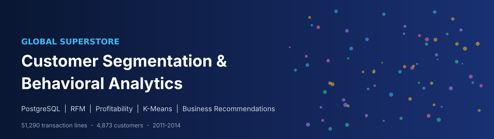
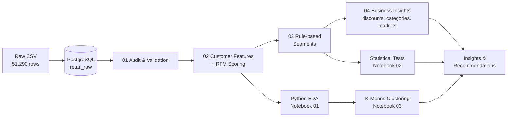
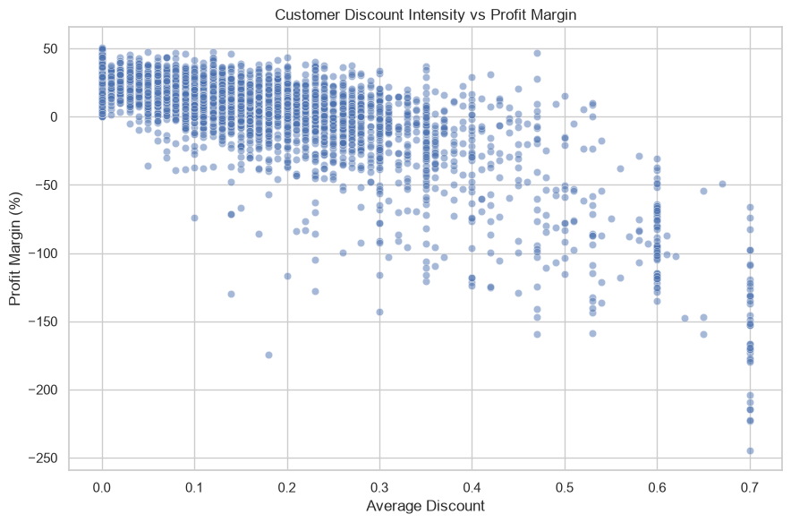
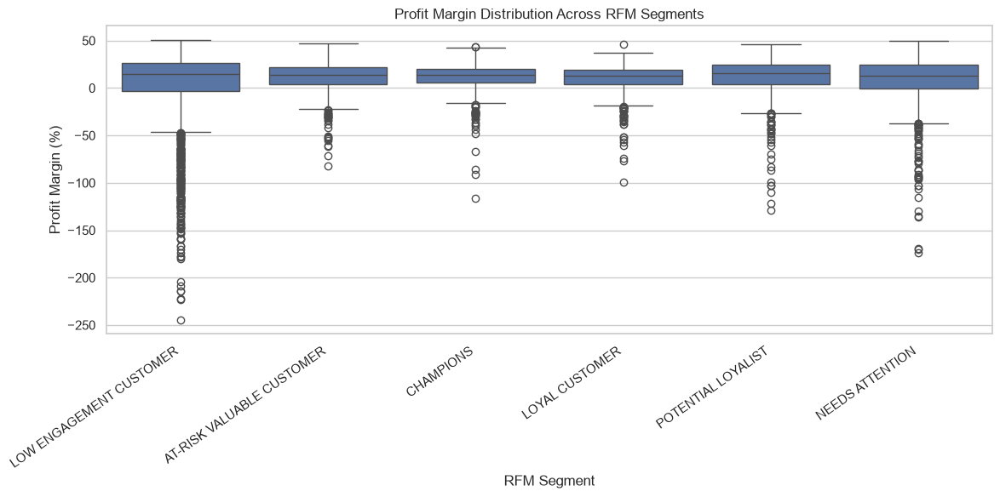
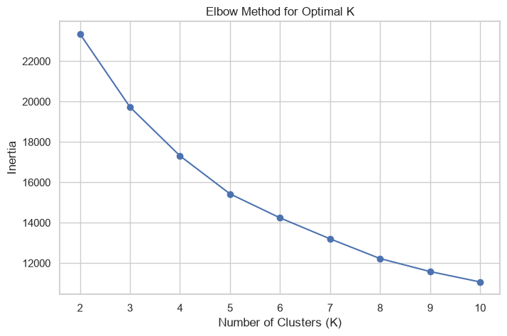
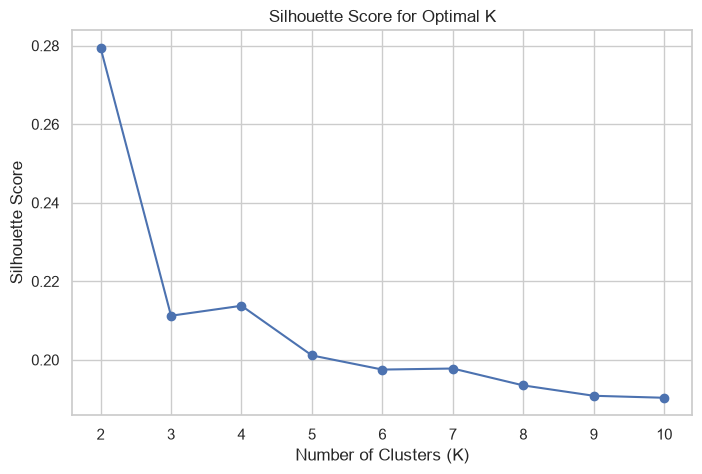
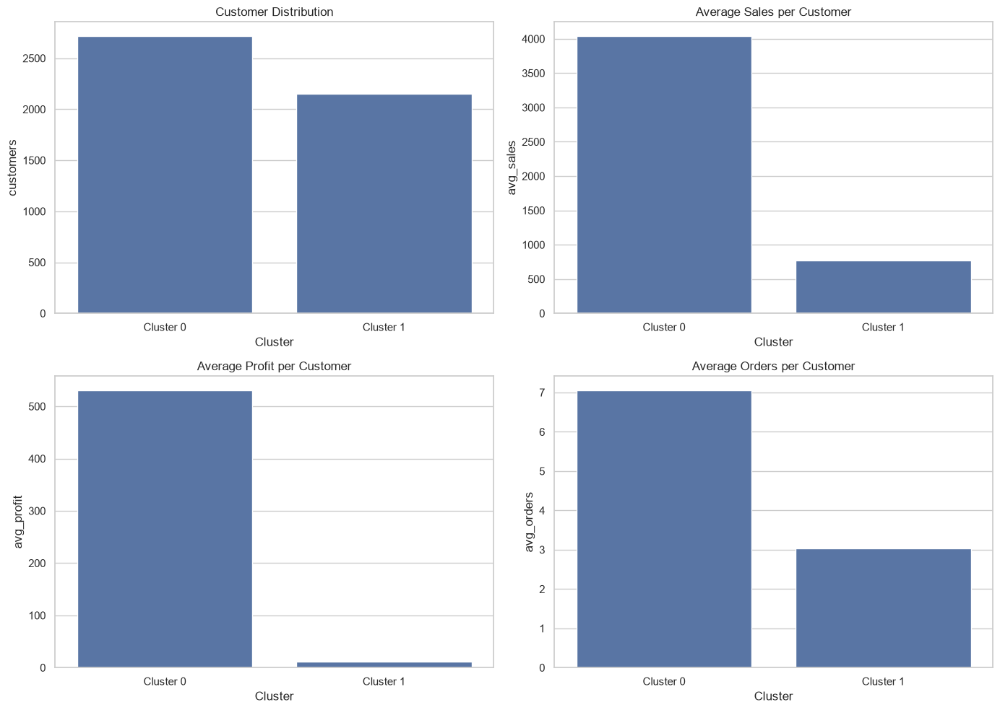

<p align="center">
  
</p>

<p align="center">
  
  
  
  
  
</p>

<h3 align="center">Which customers actually make the business money, and which ones only look good on a revenue chart?</h3>

<p align="center">
  <a href="report/PROJECT_REPORT.md"><b>Read the full report</b></a> &nbsp;|&nbsp;
  <a href="sql/">SQL scripts</a> &nbsp;|&nbsp;
  <a href="notebooks/">Python notebooks</a> &nbsp;|&nbsp;
  <a href="#-key-findings">Key findings</a>
</p>

---

## The 30-second summary

A retailer sells across 7 markets and 3 business segments. Revenue looks healthy, but **about 1 in 4 transaction lines loses money**. I built an end-to-end analytics pipeline, from raw PostgreSQL table to customer segments to statistical tests to K-Means clustering, to answer:

1. **Who are our valuable, at-risk and low-engagement customers?** (RFM segmentation)
2. **Where do sales fail to turn into profit?** (discounts, categories, markets)
3. **Do rule-based segments agree with a data-driven (K-Means) view?**
4. **What should the business do next, and how would we measure it?**

## At a glance

| | |
|---|---|
| **Transaction lines** | 51,290 (27 fields, 0 nulls, 0 duplicates) |
| **Customers** | 4,873 |
| **Period** | Jan 2011 - Dec 2014 |
| **Total sales / profit** | ~$12.6M / ~$1.47M (~11.6% aggregate margin) |
| **Loss-making lines** | 12,544 (24.5% of all lines) |
| **Customer segments** | 6 mutually exclusive RFM segments |
| **Discount vs profit margin (customer level)** | Spearman rho = **-0.65** |
| **K-Means** | k = 2, silhouette = 0.28 |

## Pipeline



## Business questions answered in SQL

| # | Business question | Script |
|---|---|---|
| 1 | Do discounts destroy margin? | [`04`](sql/04_business_insights.sql) Q1 |
| 2 | Which big customers are loss-making? | `04` Q2 |
| 3 | How concentrated are sales and profit in top customers? | `04` Q3 |
| 4 | Which categories sell well but earn little? | `04` Q4 |
| 5 | Which markets combine heavy discounts with weak margin? | `04` Q5 |
| 6 | Which large countries have low value per customer? | `04` Q6 |
| + | Who is Champion, At-Risk or Low-Engagement, and how much do they contribute? | [`03`](sql/03_customer_segmentation.sql) |

<details>
<summary><b>Sample: Q1 - do discounts destroy margin?</b> (click to expand)</summary>

```sql
WITH banded AS (
    SELECT
        CASE WHEN discount = 0     THEN '1. No discount'
             WHEN discount <= 0.20 THEN '2. Low (0-20%]'
             WHEN discount <= 0.40 THEN '3. Medium (20-40%]'
             ELSE                       '4. High (>40%)' END AS discount_band,
        sales, profit
    FROM retail_raw
)
SELECT discount_band,
       COUNT(*)                                                 AS transaction_lines,
       ROUND((100.0 * SUM(profit) / NULLIF(SUM(sales), 0))::numeric, 2) AS profit_margin_pct
FROM banded
GROUP BY discount_band
ORDER BY discount_band;
```
Medium and high discount bands show negative aggregate margin. See the [report](report/PROJECT_REPORT.md#34-business-insights---04_business_insightssql) for the full output.
</details>

<details>
<summary><b>Sample: explainable RFM segmentation</b> (click to expand)</summary>

```sql
CASE
    WHEN r_score >= 4 AND f_score >= 4 AND m_score >= 4 THEN 'CHAMPIONS'
    WHEN f_score >= 4 AND r_score >= 3 AND m_score >= 3 THEN 'LOYAL CUSTOMER'
    WHEN r_score <= 2 AND f_score >= 3 AND m_score >= 3 THEN 'AT-RISK VALUABLE CUSTOMER'
    WHEN r_score >= 4 AND f_score >= 2 AND m_score >= 2 THEN 'POTENTIAL LOYALIST'
    WHEN r_score + f_score + m_score BETWEEN 7 AND 9    THEN 'NEEDS ATTENTION'
    ELSE 'LOW ENGAGEMENT CUSTOMER'
END AS segment
```
Rules run top-down, so every customer lands in exactly one segment.
</details>

## Key findings

> Numbers below come from the Python notebooks in this repo. SQL results are in the [report](report/PROJECT_REPORT.md).

**1. Revenue is not the same as profit.** The #1 customer by sales (about $25.0K) is *loss-making* (about -$1.98K) with a 25% average discount. Sorting customers by sales alone would reward the wrong people.

**2. Discounting is the strongest lever on margin.** Customer-level average discount and profit margin are strongly negatively related (Pearson -0.76, Spearman -0.65, p < 0.001).

**3. RFM segments differ in *how engaged* customers are, not in *how profitable* they are.** A Kruskal-Wallis test finds a statistically significant difference in profit margin across the six segments (H = 17.6, p = 0.0034), but the effect size is negligible (epsilon-squared = 0.0026). *Statistical significance is not business importance.*

**4. Two natural customer groups emerge in K-Means.**

| Cluster | Customers | Avg recency (days) | Avg orders | Avg sales | Avg profit | Approx. margin |
|---|---|---|---|---|---|---|
| 0 - Active & valuable | 2,719 (55.8%) | 110 | 7.1 | $4,043 | $531 | ~13.1% |
| 1 - Lapsed & low-value | 2,154 (44.2%) | 330 | 3.0 | $766 | $11 | ~1.4% |

**5. Rule-based and data-driven views agree.** 795 of the 796 *Champions* land in Cluster 0; 62% of Cluster 1 are *Low Engagement* customers.

| RFM segment | Customers | Share |
|---|---|---|
| Low Engagement | 1,485 | 30.5% |
| Champions | 796 | 16.3% |
| Needs Attention | 694 | 14.2% |
| Potential Loyalist | 685 | 14.1% |
| Loyal Customer | 616 | 12.6% |
| At-Risk Valuable | 597 | 12.3% |

## Charts

<table>
<tr>
<td><br><sub>Discount intensity vs profit margin</sub></td>
<td><br><sub>Profit margin by RFM segment</sub></td>
</tr>
<tr>
<td><br><sub>Elbow method</sub></td>
<td><br><sub>Silhouette scores</sub></td>
</tr>
<tr>
<td colspan="2"><br><sub>Cluster comparison dashboard</sub></td>
</tr>
</table>

## Business recommendations (summary)

| # | Recommendation | Target group | Success metric |
|---|---|---|---|
| 1 | Cap or review discounts above 20-40% in categories with negative margin | High-discount transactions | Margin on discounted lines |
| 2 | Run a win-back pilot with a holdout group | *At-Risk Valuable* (597 customers) | Reactivation rate vs control |
| 3 | Activate second purchases | Low-frequency / lapsed cluster | Repeat-purchase rate |
| 4 | Protect and reward profitable loyalty | *Champions* + *Loyal* | Retention, margin per customer |
| 5 | Review pricing for high-sales, loss-making customers | Top-sales loss-makers | Profit per customer |

Full evidence, assumptions and limitations: **[report/PROJECT_REPORT.md](report/PROJECT_REPORT.md)**.

## Repository structure

```
global-superstore-customer-segmentation/
|-- README.md
|-- report/
|   `-- PROJECT_REPORT.md        # full write-up: method, findings, recommendations
|-- sql/
|   |-- 00_schema_reference.sql          # raw table DDL
|   |-- 01_data_audit_and_prep.sql       # can we trust the data?
|   |-- 02_customer_features_and_rfm.sql # one row per customer + RFM scores
|   |-- 03_customer_segmentation.sql     # 6 explainable segments (view used by Python)
|   |-- 04_business_insights.sql         # 6 business questions: discounts, loss-makers, concentration...
|   `-- archive_full_scripts/            # original 8 exploratory phase scripts
|-- notebooks/
|   |-- 01_EDA_and_Data_Preparation.ipynb
|   |-- 02_Statistical_Analysis.ipynb
|   `-- 03_Customer_Segmentation.ipynb
|-- images/                      # banner, charts, SQL output screenshots
|-- docs/Project_Roadmap.pdf     # original project plan
|-- data/README.md               # how to obtain the dataset
`-- requirements.txt
```

## Skills demonstrated

| Area | What this project shows |
|---|---|
| **SQL** | CTEs, window functions (`NTILE`, `ROW_NUMBER`, `RANK`), `FILTER`, `PERCENTILE_CONT`, views, `CASE` rule engines, correct grain handling (line vs order vs customer) |
| **Data quality** | Null, duplicate, range and date-logic audits; negative profit treated as a business outcome, not an error |
| **Analytics thinking** | RFM design, Pareto concentration, discount band analysis, customer-level profitability |
| **Statistics** | Normality-aware test choice (Kruskal-Wallis), Dunn post-hoc with Bonferroni, effect size, Pearson vs Spearman |
| **Machine learning** | Feature selection by correlation, log1p transform, scaling, elbow + silhouette, cluster profiling, comparison with rules |
| **Communication** | Business question -> evidence -> recommendation -> success metric |

## How to run

```bash
# 1. Clone and install
git clone https://github.com/joydeepdattacodes/global-superstore-customer-segmentation.git
cd global-superstore-customer-segmentation
pip install -r requirements.txt

# 2. Load the data into PostgreSQL (see data/README.md), then run sql/01 ... sql/04 in order

# 3. Set database credentials (never commit passwords)
export PGUSER=postgres PGPASSWORD=yourpassword PGDATABASE=superstore_project


# 4. Run notebooks in order
jupyter notebook notebooks/
```

## Limitations and next steps

- **Observational data.** Discount and profit are associated, not proven causal.
- **RFM reference date** is 2015-01-01 (day after last order); it is a convention, not evidence of later activity.
- **Rule design.** The `ELSE` branch of the segmentation groups very different customers into *Low Engagement*; a threshold-sensitivity test is a planned improvement.
- **K = 2** maximises silhouette but gives a coarse split; k = 4 is worth exploring for richer personas.
- **Planned:** analysis-ready clean table with reconciliation, segment-stability test, category cross-sell pairs, interactive dashboard.

## About me

**[Joydeep Datta]** - BSc Statistics (Honours), Banaras Hindu University. Aspiring Data Analyst focused on SQL, Python and business problem solving.

[LinkedIn](https://www.linkedin.com/in/joydeep-datta-435368414)| [Email](mailto:joydeepdatta.dv@gmail.com) | [Portfolio](https://github.com/joydeepdattacodes)

<p align="center"><sub>If you found this useful, a star on the repo is appreciated.</sub></p>
