# Global Superstore - Customer Segmentation & Behavioral Analytics
### Project Report

**Author:** [Your Name] &nbsp;|&nbsp; **Tools:** PostgreSQL, Python (pandas, scikit-learn, SciPy), Jupyter &nbsp;|&nbsp; **Data:** Global Superstore, 2011-2014

> **How to complete this report:** every grey box *"YOUR OUTPUT GOES HERE"* is a placeholder image. Take a screenshot of the matching query result and save it with the **same file name** in `images/sql_outputs/` - the report updates automatically. Lines starting with **Your finding** are blanks for your own numbers and interpretation. Sections using Python results are already filled from the notebooks.

---

## 1. Executive Summary

**Business problem.** The retailer reports healthy sales, but 24.5% of its transaction lines (12,544 of 51,290) lose money. Management needs to know *which customers create profit, which ones are slipping away, and where discounts destroy value.*

**Approach.** Raw data was audited in PostgreSQL, aggregated to one row per customer, scored with RFM, split into six rule-based segments, and then analysed for profitability, discounts, categories and markets. Python added statistical testing and K-Means clustering as an independent check.

**Headline results**

| Finding | Evidence |
|---|---|
| Sales and profit tell different stories | Top customer by sales (~$25.0K) is loss-making (~-$1.98K) |
| Discounts erode margin | Customer-level discount vs margin: Pearson -0.76, Spearman -0.65 |
| RFM segments differ in engagement more than profitability | Kruskal-Wallis p = 0.0034 but epsilon-squared = 0.0026 |
| Two clear customer groups | 55.8% active/valuable (avg profit $531) vs 44.2% lapsed (avg profit $11) |
| Rule-based and K-Means views agree | 795 of 796 Champions fall in the active cluster |
| Sales concentration | Top 20% of customers generate ___% of sales and ___% of profit *(fill from Q3)* |

---

## 2. Data & Scope

| Item | Value |
|---|---|
| Source | Global Superstore transaction-line data |
| Rows x fields | 51,290 x 27 |
| Distinct customers | 4,873 |
| Distinct orders / products | 25035 / 10292 |
| Order dates | 2011-01-01 to 2014-12-31 |
| Ship dates | up to 2015-01-07 |
| Missing values / exact duplicates | 0 / 0 |
| Loss-making lines | 12,544 (24.5%) |
| Shipping time | 0-7 days, mean 3.97 days; 2,600 same-day shipments |

**Grain rules used throughout:** transaction line (`row_id`), order (`order_id`), customer (`customer_id`). Order counts use `COUNT(DISTINCT order_id)`. Aggregate margin = `SUM(profit) / SUM(sales)`, never an average of row-level margins.

**Scope.** The data has no demographics and no campaign outcomes, so findings describe *behavior and associations*, not causal effects.

---

## 3. Methodology & Findings

The SQL work is organised into four scripts, one per stage. The original eight phase scripts are kept in [`sql/archive_full_scripts/`](../sql/archive_full_scripts/).

### 3.1 Data audit & validation - [`01_data_audit_and_prep.sql`](../sql/01_data_audit_and_prep.sql)
**Question:** can the data be trusted? Checked counts, key uniqueness, nulls, exact and soft duplicates, date window, date logic and numeric ranges.

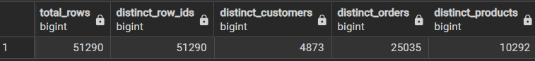

- All `row_id` values are unique; one order holds several lines and one customer places several orders, so order counts always use `COUNT(DISTINCT order_id)`.
- No nulls and no exact duplicate rows.
- 12,544 negative-profit lines (24.5%) were **kept**: they are business outcomes (discount-driven losses), not data errors.
- One line has sales rounded to 0 with profit -1.11 (discount 0.8); kept and documented.
- Repeated `order_id + product_id` pairs were inspected, not deleted (repetition alone does not prove duplication).

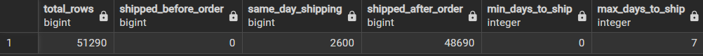
- No line ships before it is ordered; shipping takes 0-7 days.

**Key Finding:** The dataset contains 51,290 transaction lines representing 4,873 customers, 25,035 distinct orders and 10,292 distinct products. Although 38 order-product combinations appeared twice (76 rows), these records were retained after inspection rather than automatically classified as duplicates. A notable finding was that 24.5% of transaction lines recorded negative profit, highlighting the importance of distinguishing genuine business losses from data-quality errors.

### 3.2 Customer features & RFM - [`02_customer_features_and_rfm.sql`](../sql/02_customer_features_and_rfm.sql)
**Question:** who are our customers in terms of value, loyalty and activity?

A single view, `customer_features`, produces exactly one row per customer (orders, sales, profit, AOV, items per order, breadth, active months, discount exposure, margin, dominant category).

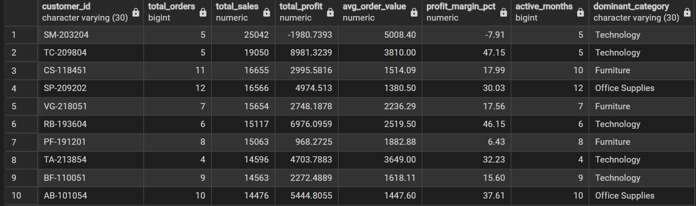

Distribution of the customer table (from Python):

| Metric | Mean | Median | Max | Skewness |
|---|---|---|---|---|
| Total sales | $2,594 | $1,894 | $25,042 | 1.69 |
| Total profit | $301 | $189 | $8,981 (min -$6,626) | 1.16 |
| Orders | 5.28 | 5 | 18 | 0.53 |
| Avg order value | $461 | $375 | $5,100 | 2.84 |
| Recency (days) | 207 | 110 | 1,460 | 2.13 |
| Avg discount | 14.2% | 12% | 70% | 1.47 |

All key measures are right-skewed, which motivated rank-based tests and log transforms later.

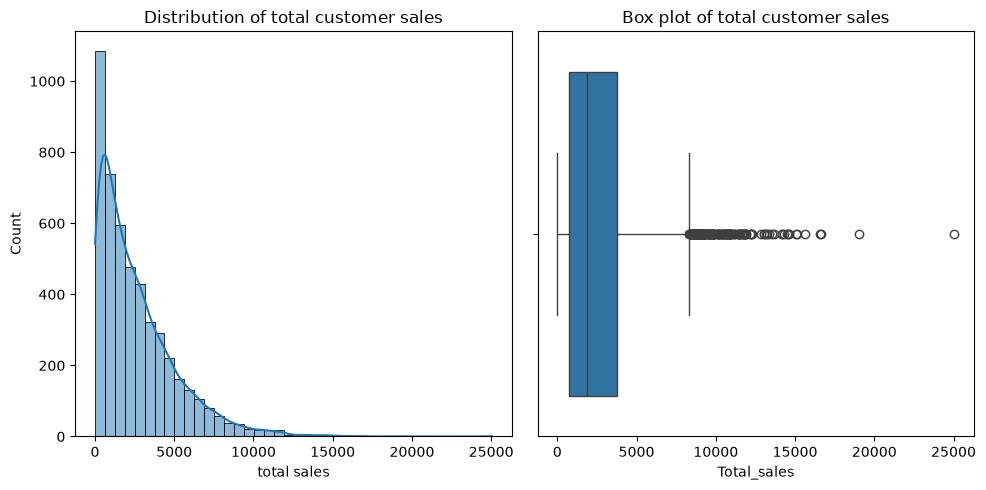

**RFM design**
- **Reference date:** 2015-01-01 (day after the latest order, 2014-12-31), so the most recent buyer has recency = 1 day.
- **Recency** = days since last order; **Frequency** = distinct orders; **Monetary** = total sales.
- **Scores:** `NTILE(5)` per dimension, oriented so 5 = best. A sanity query checks the direction.
- **Conflicting signals:** (A) above-average sales but loss-making, (B) above-average sales but lapsed beyond the 75th-percentile recency, (C) RFM >= 12 but margin below the 25th percentile. Thresholds are computed in SQL, not hard-coded.

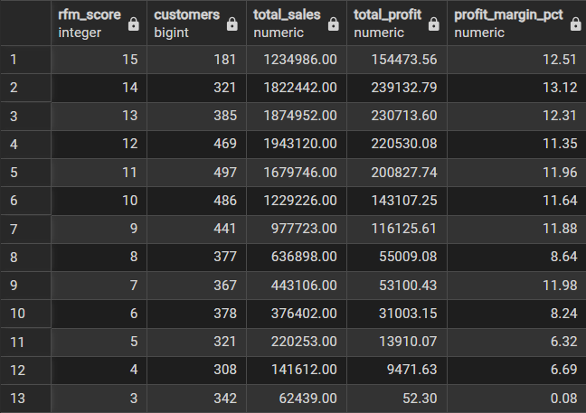
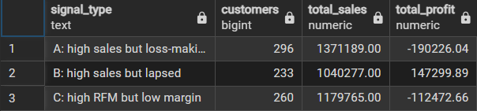
**Key Findings:** Higher RFM scores generally corresponded to greater sales and profit contributions, although profitability margins did not increase consistently. The conflicting-signal analysis further identified 296 high-sales loss-making customers contributing $190,226 in losses, while 233 high-sales customers represented potential reactivation opportunities. Notably, 260 high-RFM customers also had below-25th-percentile profit margins, reinforcing that customer engagement and revenue alone are insufficient measures of customer profitability.

### 3.3 Explainable segmentation - [`03_customer_segmentation.sql`](../sql/03_customer_segmentation.sql)
**Question:** which groups deserve which treatment, and how much of the business does each carry?

Rules are evaluated top-down, so every customer lands in exactly one segment.

| Segment | Rule | Customers | Share |
|---|---|---|---|
| Champions | R>=4, F>=4, M>=4 | 796 | 16.3% |
| Loyal Customer | F>=4, R>=3, M>=3 | 616 | 12.6% |
| At-Risk Valuable | R<=2, F>=3, M>=3 | 597 | 12.3% |
| Potential Loyalist | R>=4, F>=2, M>=2 | 685 | 14.1% |
| Needs Attention | RFM score 7-9 | 694 | 14.2% |
| Low engagement| everything else | 1,485 | 30.5% |

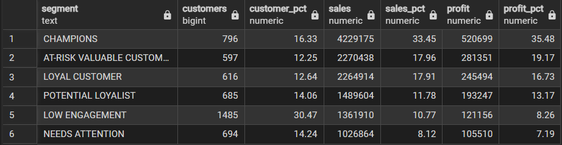

**Key Finding:** Champions represent only 16.33% of customers but generate 33.45% of sales and 35.48% of total profit, making them the strongest commercial segment. At-Risk Valuable customers also contribute disproportionately to profit (19.17%), highlighting the importance of retention efforts. In contrast, Low engagement customers account for 30.47% of customers but contribute just 8.26% of profit.

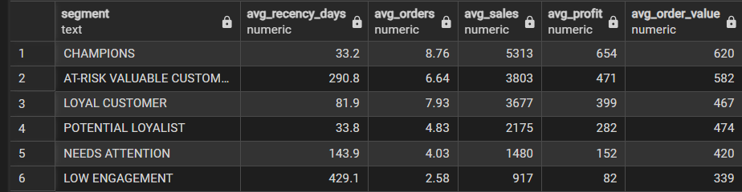
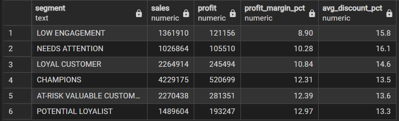

**Key Findings:** Champions contribute disproportionately to business performance, generating 35.48% of total profit from just 16.33% of customers. At-Risk Valuable customers also represent an important retention opportunity, while Other / Mixed Profile customers show the weakest engagement and lowest profit margin (8.90%). Interestingly, Potential Loyalists achieve the highest profit margin (12.97%) with the lowest average discount (13.3%), whereas Needs Attention customers receive the highest average discount (16.1%). These differences highlight the importance of segment-specific retention and discount strategies.

**Statistical check (Python, notebook 02).** Profit margin differs across segments (Kruskal-Wallis H = 17.64, p = 0.0034), but the effect is tiny (epsilon-squared = 0.0026). Dunn post-hoc tests with Bonferroni correction find at least one significantly different pair (minimum adjusted p about 0.0015).

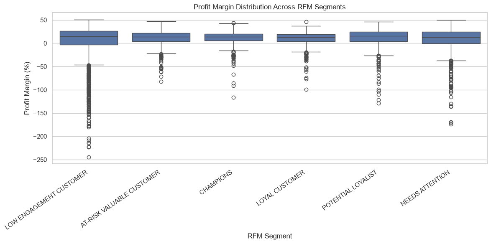

**Interpretation.** RFM answers *how engaged is this customer*, not *how profitable*. Profitability needs its own analysis, which is what script 04 does.

### 3.4 Business insights - [`04_business_insights.sql`](../sql/04_business_insights.sql)
Six questions a manager could act on. *"Segment" in this script means the dataset's business segment (Consumer / Corporate / Home Office).*

**Q1. Do discounts destroy margin?** Lines grouped into none / low (0-20%] / medium (20-40%] / high (>40%) bands.
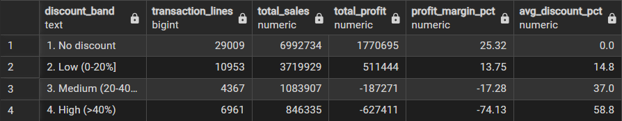
- Medium and high bands show **negative** aggregate margin in the SQL output.

**Key Finding:** Profit margins declined sharply as discount levels increased, falling from 25.32% without discounts to 13.75% in the low-discount band. Medium and high-discount transactions generated negative margins of -17.28% and -74.13%, respectively. Furniture recorded the largest loss under high discounts ($221,178), while all three categories were loss-making in both medium- and high-discount bands. This highlights substantial profitability risks associated with aggressive discounting.

Python confirms the pattern at customer level:

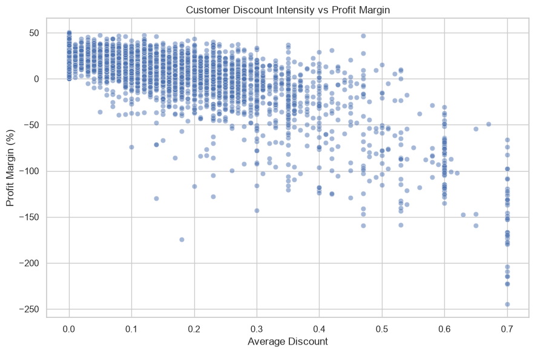

| Test | Coefficient | p-value |
|---|---|---|
| Pearson | -0.758 | < 0.001 |
| Spearman | -0.655 | < 0.001 |

These are associations, not proof of cause: discounts may be targeted at products that already have thin margins.

**Q2. Which high-sales customers are loss-making or low-margin?** Top-quartile sales with negative profit or margin below 5%.
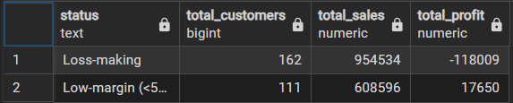

**Key Finding:** Among the top-quartile customers by sales, 162 were loss-making, generating $118,009 in combined losses, while another 111 customers had profit margins below 5%. Together, these 273 customers generated $1.56 million in sales but a net loss of $100,359, demonstrating that high customer revenue does not necessarily translate into profitability._

**Q3. How concentrated are sales and profit?** Top 1 / 5 / 10 / 20% of customers by sales.
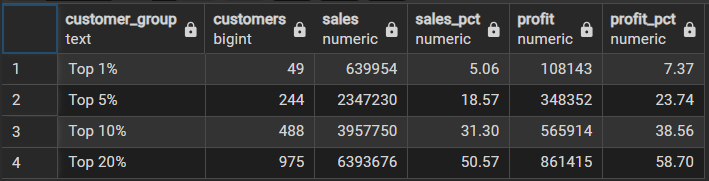

**Key Finding:** Customer contributions are concentrated among the highest-value customers. The top 20% account for 50.57% of total sales and 58.70% of total profit, while the top 10% alone contribute 38.56% of profit. Their disproportionately high profit contribution highlights the importance of retaining high-value customers.

**Q4. Which categories sell a lot but earn little?**
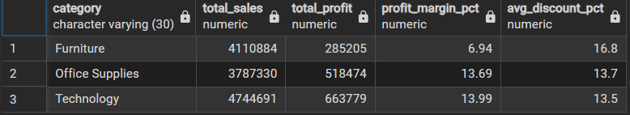
**Key Finding:** Furniture has the weakest category-level profit margin (6.94%), considerably below Office Supplies (13.69%) and Technology (13.99%). At the sub-category level, Tables generated $757,034 in sales but incurred a loss of $64,083, with an average discount of 29.1%. Machines also showed relatively weak profitability, suggesting that high sales do not always translate into healthy margins._

**Q5. Which markets combine heavy discounting with weak margin?**
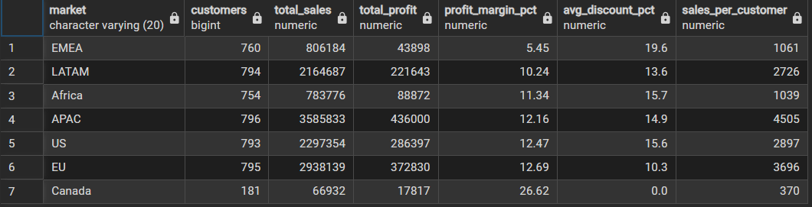
**Key Finding:** EMEA recorded the weakest market performance, with a profit margin of 5.45%, the highest average discount (19.6%) and sales per customer of just $1,061. In comparison, EU achieved a 12.69% margin with an average discount of 10.3%. This suggests that EMEA's discounting and market-level sales performance deserve further investigation.

**Q6. Which large countries have below-average value per customer?**
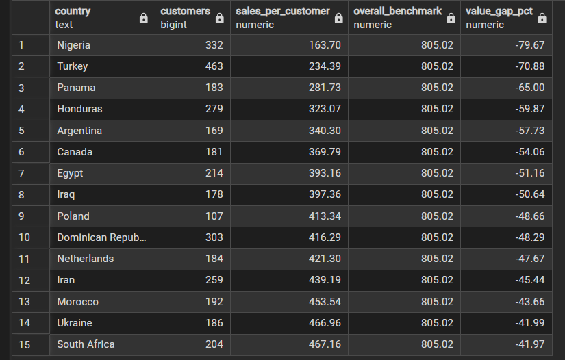
**Key Finding:** Among countries with at least 100 customers, Nigeria recorded the largest gap in sales per customer, at $163.70—79.67% below the overall average of $805.02. Turkey and Honduras also showed substantially lower customer value, with gaps of 70.88% and 59.87%, respectively. These markets may warrant further investigation into purchasing behaviour and customer value.

---

## 4. Python Analytics & Clustering

### 4.1 EDA (`notebooks/01_EDA_and_Data_Preparation.ipynb`)
Strong positive skew in sales, profit, shipping cost and discount; customer-level correlations (Spearman): orders-sales 0.74, sales-AOV 0.85, discount-profit -0.38.

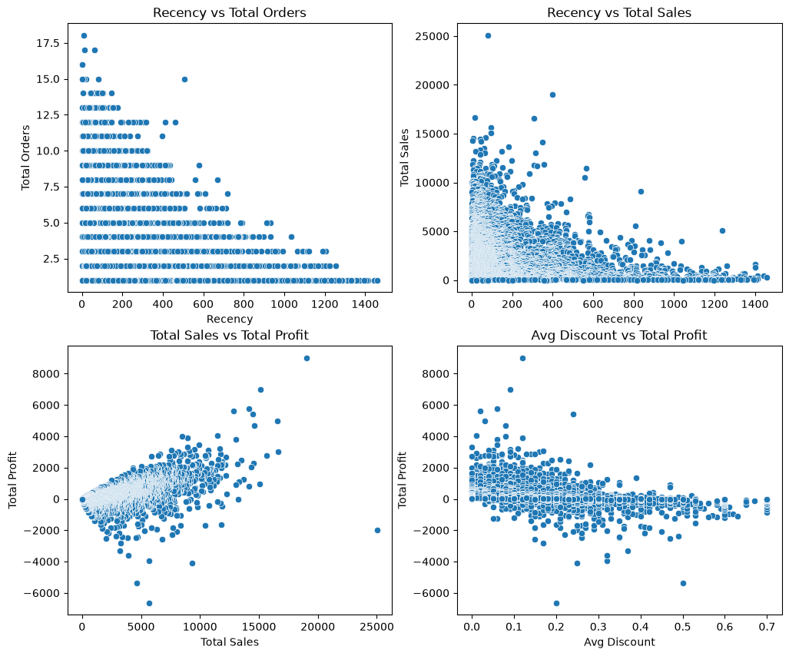

### 4.2 Feature selection for K-Means (`notebooks/03_Customer_Segmentation.ipynb`)
- Removed redundant features: `active_months` (r = 0.97 with orders), `total_quantities` and `profit_margin`.
- Kept: recency, total orders, total sales, total profit, AOV, average discount, unique products.
- Applied `log1p` to recency, total sales and AOV, then `StandardScaler`.

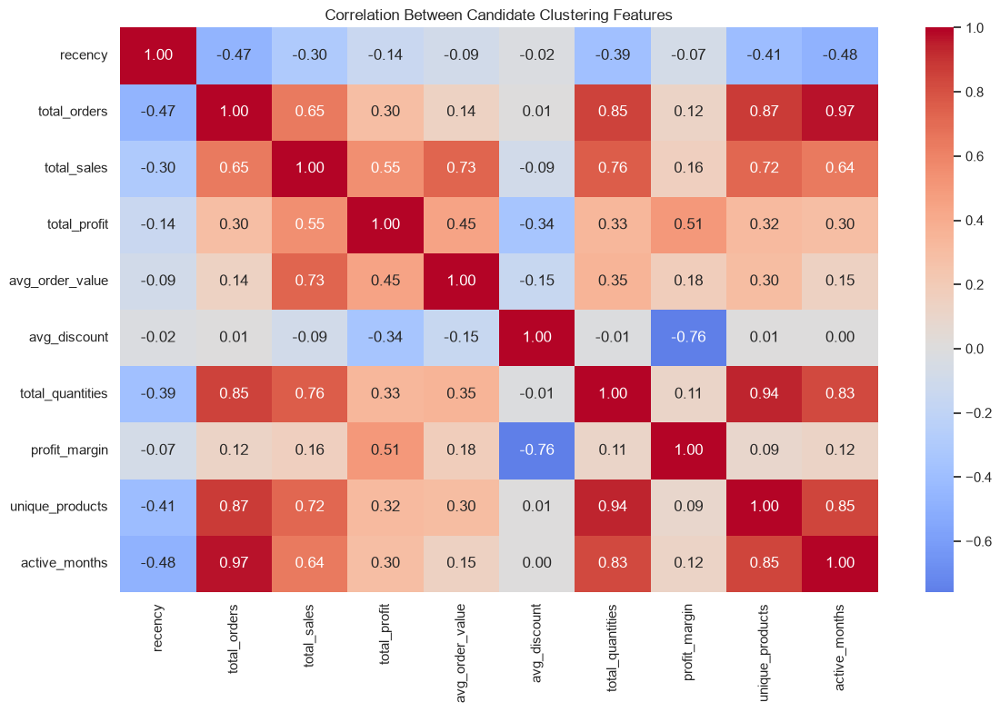

### 4.3 Choosing k

| k | Silhouette |
|---|---|
| 2 | **0.279** |
| 3 | 0.211 |
| 4 | 0.214 |
| 5 | 0.201 |
| 6 | 0.198 |

k = 2 was selected for the highest silhouette score. The elbow curve shows no sharp bend, so k = 2 is a coarse but stable split.

### 4.4 Cluster profile

| Cluster | Customers | Recency | Orders | Avg sales | Avg profit | AOV | Avg discount | Unique products |
|---|---|---|---|---|---|---|---|---|
| 0 - Active & valuable | 2,719 (55.8%) | 110 | 7.06 | $4,043 | $531 | $613 | 13% | 14.6 |
| 1 - Lapsed & low-value | 2,154 (44.2%) | 330 | 3.04 | $766 | $11 | $270 | 16% | 5.3 |

### 4.5 SQL segments vs K-Means clusters

| SQL segment | Cluster 0 | Cluster 1 |
|---|---|---|
| Champions | 795 | 1 |
| Loyal Customer | 610 | 6 |
| At-Risk Valuable | 522 | 75 |
| Potential Loyalist | 465 | 220 |
| Needs Attention | 177 | 517 |
| Low Engagement | 150 | 1,335 |

The two methods agree on the extremes (Champions/Loyal vs Low Engagement). Neither is treated as ground truth.

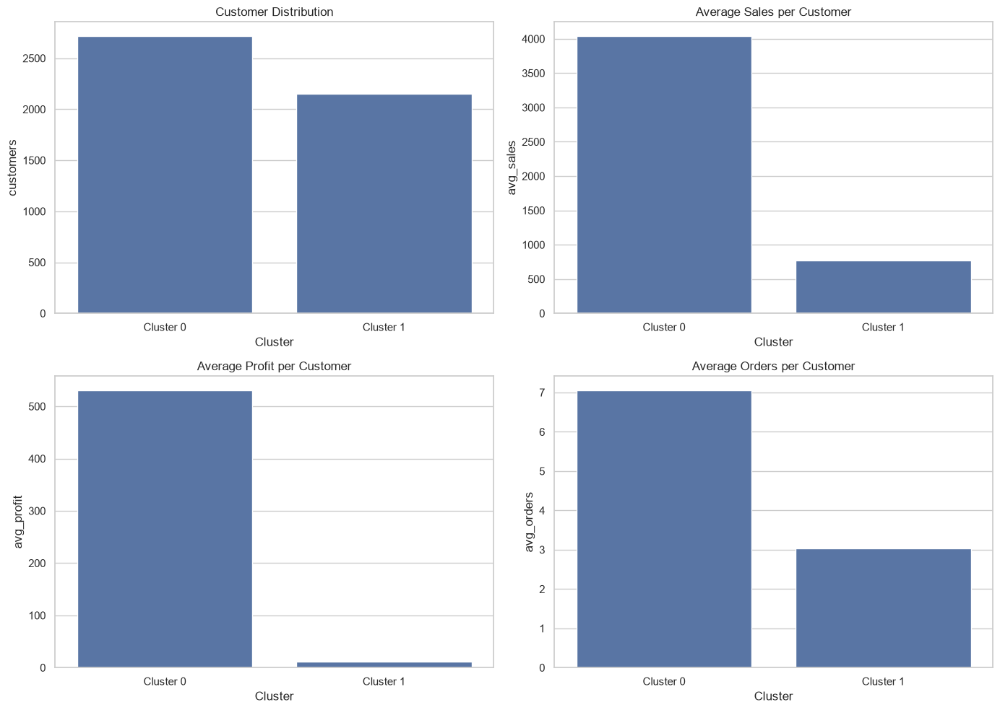

---

## 5. Recommendations

| # | Recommendation | Target group | Evidence | Action | Success metric |
|---|---|---|---|---|---|
| 1 | Review discount depth | Lines with discount > 20% | Negative margin in medium/high bands; rho = -0.65 | Set approval thresholds / floor margin by category | Margin on discounted lines |
| 2 | Win-back pilot | At-Risk Valuable (597) | High R-prior value, recency > 269-day cohort | Offer to half, hold out half | Reactivation rate vs control |
| 3 | Second-purchase activation | Cluster 1 / low frequency | Avg 3 orders, margin ~1.4% | Post-purchase nudges on profitable categories | Repeat rate, margin per order |
| 4 | Protect core customers | Champions + Loyal (1,412) | Cluster 0: avg profit $531 | Loyalty perks not funded by deep discounts | Retention, profit per customer |
| 5 | Re-price loss-making big buyers | High-sales, loss-making customers | Top customer loses ~$1.98K on $25K sales | Account-level pricing review | Profit per customer |
| 6 | Review Furniture Discounting | Furniture / Tables | Tables lost $64K; 29.1% average discount | Review pricing and discount limits | Tables profit margin |

Recommendations are proportional to the evidence; each should be run as a measurable pilot rather than assumed to work.

---

## 6. Limitations & Assumptions

| Limitation | Impact | Mitigation |
|---|---|---|
| Observational data | No causal claims on discounts | Frame actions as pilots with control groups |
| RFM reference date 2015-01-01 | Recency depends on this convention | Document it; test alternatives |
| Rule order and `ELSE` bucket | *Low Engagement* mixes very different customers (e.g. a high-spend customer with R=3, F=3) | Add a sensitivity test and a "High value, low recency" rule |
| k = 2 | Coarse personas | Explore k = 4 and compare stability |
| Script 04 uses the dataset's business segment | Not comparable to RFM segments | Stated explicitly in the script |
| No clean table / threshold-sensitivity SQL yet | Reproducibility could be stronger | Planned next step |

---

## 7. Reproducibility
See the [README](../README.md#how-to-run). SQL scripts run in order (`00` to `04`); notebooks read credentials from environment variables.
